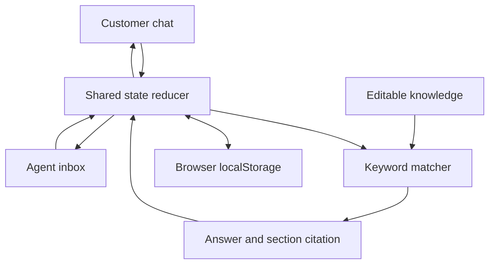

# RelayDesk

### Thoughtful support, connected.

RelayDesk is an interactive customer-support portfolio demo for **Northstar Commerce**, a fictional ecommerce software company. Explore a shared team inbox, a customer chat with transparent simulated AI, and an editable knowledge base. Every workflow runs in your browser with fictional data—no backend, API keys, external AI calls, or real authentication.

**Interactive demo • Fictional data • Simulated AI**

Built by [@Xeyzen7959](https://github.com/Xeyzen7959).

## Experience the demo

- **Overview:** live counts of open, unassigned, awaiting-human, and resolved conversations; clickable filters; current topic distribution and activity.
- **Shared inbox:** search messages, filter by status and assignee, assign teammates, change status, send replies, add private notes, and review editable suggested replies.
- **Chat playground:** ask typed or example questions, see simulated typing, open section citations, and hand off to a human. Inbox replies appear in the same customer thread.
- **Knowledge:** search and filter eight seeded documents; create, edit, and delete text sections. Edits influence the next answer. Deleted citations show an unavailable-source state.
- **Settings:** change workspace copy, toggle automatic replies, try agent/viewer roles, and reset the entire demo with confirmation.
- **Local persistence:** changes survive reloads. Invalid or old saved data resets gracefully; unavailable browser storage produces a visible session-only warning.
- **Responsive navigation:** three inbox panels on wide screens, a context toggle on tablets, and one panel at a time with back controls on mobile. Native controls, visible focus, a skip link, and reduced-motion styles are included.

### A customer-to-agent walkthrough

1. Open **Chat playground** and choose “How long does standard shipping take?”
2. Click the **Shipping & delivery · §1** citation to inspect its exact source.
3. Choose **Talk to the team**. The shared conversation becomes “Needs a human,” and automatic replies pause.
4. Open **Continue as a support agent**, write a reply, and add a separate internal note.
5. Return to the playground. The staff reply is visible; the internal note is private to the team UI.
6. Use **Resume AI** in the inbox before expecting automatic answers again. The global automatic-replies setting must also be on.
7. Edit a knowledge section and ask a related question again to see the change. Use **Reset demo** for a fresh start.

The initial workspace contains **3 staff members, 12 conversations, and 8 knowledge documents**. Seed timestamps are fixed sample timestamps, not live customer activity. There are no historical charts or invented accuracy metrics.

## Screenshots

Genuine screenshots were not captured: the supported browser-testing integration was unavailable in the build environment. Images are intentionally omitted. `docs/screenshots/` is reserved for future actual desktop and mobile captures. DOM tests do not substitute for visual browser testing.

## Local data flow



All screens read the same state. Notes and activity events are filtered out of the customer view. Handoff sets a pause flag that only an explicit resume clears. This separation is an interface simulation, not a confidentiality or security boundary.

## Stack & structure

**React · TypeScript · Vite · CSS · lucide-react**

Runtime dependencies are limited to React, React DOM, and Lucide. Tests use Node’s built-in test runner; jsdom and esbuild are development-only dependencies for DOM interaction tests.

```text
src/
  App.tsx                 Application shell, persistence, hash routes, reply timer
  main.tsx                React entry point
  types.ts                Shared domain types
  styles.css              Responsive layouts and interaction states
  data/seed.ts            Fictional documents, customers, messages, and staff
  lib/matcher.ts          Inspectable scoring, action guard, citation resolution
  lib/state.ts            Reducer, filtering, validation, and persistence parsing
  components/
    Overview.tsx          Workspace metrics and activity
    Inbox.tsx             Conversation list, thread, and customer context
    Playground.tsx        Customer-facing chat and simulation explanation
    Knowledge.tsx         Text document management
    Settings.tsx          Preferences, roles, and reset
    ui.tsx                Shared dialogs, messages, avatars, and status chips
tests/
  workflows.test.ts       21 domain and persistence tests
  ui.test.tsx             7 DOM interaction tests
  run-ui.mjs              DOM test setup and TSX compilation
docs/screenshots/         Reserved for genuine captures
```

## Run on macOS

Install **Node.js 22.6 or newer** with npm. Node 24 was used for verification. Extract the source ZIP, then run these commands from Terminal in its parent directory:

```bash
cd relaydesk
npm ci
npm run dev
```

Open the local URL printed by Vite, normally `http://localhost:5173`. Keep Terminal running; press **Control+C** to stop. Use the local server rather than opening `index.html` directly.

```bash
# Type-check
npm run check

# Run domain and DOM interaction checks
npm test
npm run test:ui

# Build and inspect the production bundle locally
npm run build
npm run preview
```

Preview normally serves at `http://localhost:4173`. Development and preview scripts bind to all interfaces for container compatibility; use `npm run dev -- --host 127.0.0.1` for a Mac-only loopback server.

## Static deployment

1. Run `npm ci` and `npm run build`.
2. Upload the **contents of `dist/`** to any static host, or configure a host to build with `npm run build` and publish `dist`.
3. Serve over HTTP or HTTPS. There is no server process or backend to deploy.

`vite.config.ts` sets `base: './'`, so generated asset paths are relative. Routes use hashes such as `#/inbox` and `#/knowledge`; they work under a subdirectory without server rewrite rules. For example, a repository deployment can load `/relaydesk/#/playground`. This is an illustrative path, not a claimed live deployment URL.

For GitHub Pages, deploy the built `dist` contents through your own Pages workflow or publishing branch. Uploading the raw React source alone will not run the app. No environment variables or secrets are needed.

## How answers and citations work

The deterministic matcher in `src/lib/matcher.ts`:

1. Detects common account-action requests, order lookups, lost-authenticator problems, and requests for people. These offer handoff instead of claiming an action was performed.
2. Lowercases the question, strips punctuation, removes common stopwords, and applies simple trailing-`s` normalization.
3. Scores unique matching keywords per section: **3 points** for a section heading, **2** for a document title, or **1** for body text. Each keyword receives only its highest applicable weight.
4. Requires at least **4 points**, **2 distinct matching words**, and **25% query-word coverage**. Ties use document ID and section order.
5. Returns the winning section’s actual text with its document ID, title, numbered section, source timestamp, and exact excerpt.
6. Uses the configured fallback and offers handoff when no sufficient match exists.

Previous citations preserve the excerpt used at answer time. If the document changes, the citation dialog labels the retained excerpt as an earlier version. If the document is deleted, the dialog shows that the source is unavailable. Editing knowledge never retroactively rewrites chat history.

A short local timer creates the typing state. There is no model inference, semantic search, live order lookup, or real refund, booking, account change, email, or invitation.

## Verification

Checks performed in the build environment:

| Command | Result |
| --- | --- |
| `npm run check` | TypeScript check passed |
| `npm test` | 21 domain tests passed |
| `npm run test:ui` | 7 DOM interaction tests passed |
| `npm run build` | Vite production build passed |

The domain suite covers matching, unknown fallback, action requests, citation snapshots and deletion, handoff/pause/resume, staff replies, internal notes, filters, knowledge edits, persistence recovery, reset, and viewer guards. DOM tests exercise actual controls for chat, citation dialogs, handoff, replies, notes, filters, knowledge editing/deletion, settings, role switching, reset, persistence, mobile panel navigation, and skip-link focus.

**Verification limits:** DOM tests run in jsdom, which does not render layout. Native dialog methods and scrolling are stubbed. The supported browser integration was unavailable, so desktop/mobile visual layout, overflow, full keyboard traversal, native focus trapping, and screen-reader behavior still need manual browser verification. Text colors were adjusted against light backgrounds in source; this is not a WCAG certification. No screenshots, browser results, performance claims, or accessibility audit results are fabricated.

### Manual browser review

- Test desktop at 1440 × 900, tablet at 1024 × 768, and mobile at 390 × 844.
- Navigate with Tab/Shift+Tab and Enter; open dialogs, close with Escape, and check focus return.
- Check long titles, messages, narrow screens, text zoom, and reduced-motion preferences.
- Reload after edits. Reset, then verify the original seed is restored.
- Try unavailable localStorage and an invalid stored value under `relaydesk.demo.v1`.

## Honest limitations & a possible production architecture

This is a local-only portfolio demonstration, **not production-ready software**. Use fictional information only. It does not transmit entered messages, use analytics, authenticate users, authorize access securely, isolate tenants, synchronize browser tabs, or support real customer channels. Browser storage can be inspected or erased. Role switching is deliberately unrestricted. The heuristic matcher can miss valid questions or retrieve an irrelevant section; no AI-accuracy claim is made.

A possible production implementation would add an authenticated API, server-enforced tenant and role checks, a transactional database, secure channel integrations, a background job queue, an audited retrieval service, and a human-escalation workflow. It would also require privacy controls, retention policies, observability, evaluation, abuse prevention, and accessibility/security testing. None of those services are part of this demo.

## Author

**Built by [@Xeyzen7959](https://github.com/Xeyzen7959).**

No license has been assigned to this project.
